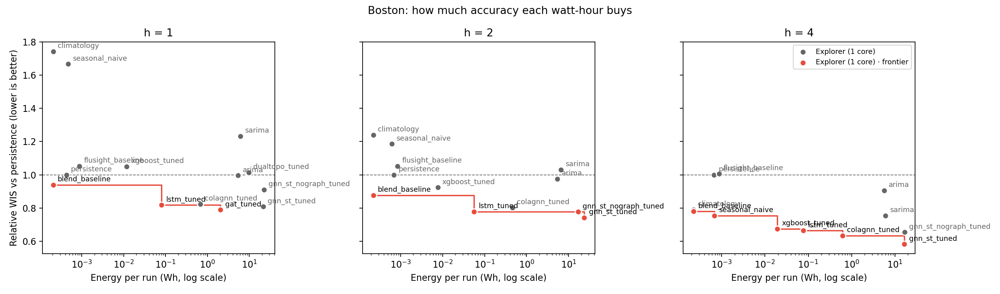

# Compute: time, energy and carbon for every model

This doc answers three questions about every model:

1. **How long does it take?** Wall-clock time per run, time spent in each phase, and seconds per epoch.
2. **What does it cost?** Electricity (kWh) and the CO2 that electricity put into the air.
3. **Is the extra accuracy worth it?** How much better each model forecasts than "next week equals this week",
   per gram of CO2, and what each step up the accuracy ladder costs.

The top half is a hand-written reference. The bottom half (between the `compute:auto` markers) is
regenerated by `python Code/compare_compute.py`. Don't edit the bottom half by hand.

---

## What is recorded, and where

Every model entrypoint wraps its work in `influenza.carbon.track_emissions`. At the end of the run,
`finish_run` writes `emissions.json` next to `metrics.csv` and prints a **receipt**:

```
┌─ gnn_st · post_covid · h2 · boston ────────────────────────────────────── receipt ┐
│ setup 1.8s  |  train 5.4s (6 ep, 0.89 s/ep)  |  eval 30.5s                        │
│ total 39.8s    energy 512 mWh    CO2 191 mg                                       │
│ ≈ 0.0341 phone charges · 0.0190 cups of tea · 2.84 m in an EV                     │
│ train share of energy ≈ 72.1 mWh (estimated by time share)                        │
│ vs last run: 1.40× slower, +90 mg CO2  (git a1b2c3d → e4f5g6h)                    │
│ power: estimated (constant TDP), whole machine, on Apple M5 · grid: massachusetts │
└───────────────────────────────────────────────────────────────────────────────────┘
```

(This is a real receipt from a 3-epoch, 2-seed smoke test. Even there, the Monte Carlo dropout
evaluation takes about 6× as long as training, which is worth knowing before anyone tunes epochs to save time.)

| Where | What |
|---|---|
| `<results>/<model>/<variant>/emissions.json` | The latest run in that directory: time, phases, energy and hardware. Always written, even with `--no-carbon` (energy is then `null`). |
| `results/_emissions/emissions.csv` | codecarbon's own append-only log for **serial** runs. It holds the full history, including 75 notebook-era rows (Windows, RTX 4060). |
| `results/_emissions/tasks/<job>_<task>.csv` | One file per cluster array task (and per parallel ablation arm). This keeps concurrent writers away from the shared CSV. |
| `results/_emissions/cluster_logs/task_*.csv` | `sweep.py --log` wall-clock per task, pulled back by `sync.sh pull`. |
| `results/_compute/` | Output of `compare_compute.py`: ledger, leaderboard, frontier plot, paper table. |

### Fields in `emissions.json`

| Field | Plain meaning |
|---|---|
| `wall_s` | Total time for the run, from process start (or from the end of the previous variant) to the end of the tracked block. |
| `setup_s` | Time spent loading data and building graphs before tracking starts. It is timed, but its energy is not metered. |
| `duration_s` | The tracked block (training + evaluation). Energy covers exactly this span. |
| `phases.train`, `phases.eval` | Seconds in each phase, summed across seeds. |
| `epochs`, `seconds_per_epoch` | Training passes, summed across seeds. For XGBoost and the severity classifier, one "epoch" is one boosted model (one per horizon per seed). |
| `kwh`, `cpu_kwh`, `ram_kwh`, `gpu_kwh` | Electricity used, in total and per component. |
| `kg_co2` | `kwh` × grid carbon intensity for `region`. |
| `measured` | `measured` means a hardware power counter was read (Intel RAPL, Apple powermetrics). `estimated (constant TDP)` or `estimated (cpu load x TDP)` means power came from the chip's rated wattage. Read the caveats below. |
| `tracking_mode` | `machine` meters the whole computer; `process` meters only this run's share of it. |
| `region` | Grid used for CO2. `massachusetts` by default (override with `GNNFLU_GRID_REGION`). |
| `cpu_share_correction`, `raw_kwh`, `raw_kg_co2` | Cluster runs only: the fix for codecarbon's whole-node billing (see caveats). The `raw_*` fields keep codecarbon's uncorrected numbers. |
| `slurm_job`, `emissions_file` | Which array task wrote it and which CSV got the row. |
| `git_sha` | The commit, so "vs last run" can show whether the code changed. |

### Which entrypoints are covered

Every model script reports time, phases and energy: `run_gnn.py`, `run_gat.py`, `run_dualtopo.py`, `run_lstm.py`,
`run_colagnn.py`, `run_xgboost.py`, `run_arima.py`, `run_seasonal_naive.py` (persistence / seasonal naive),
`run_climatology.py`, `run_flusight_baseline.py` and `run_severity_classifier.py`.

`run_shap.py` gets a receipt too, at `results/_compute/shap/<model>/emissions.json`.

The orchestrators (`sweep.py`, `run_backtest.py`, `run_ablation.py`, `run_all_horizons.py`) launch those scripts, so
each child run writes its own `emissions.json`. `run_backtest.py` also prints seconds per task on its `Epoch` lines.
`tune.py` only writes task lists, and the tuning runs it schedules are tracked like any other run.

## How to run

**Local, serial.** Nothing to do: tracking is on by default. `--no-carbon` turns energy off but keeps
time. To force a metering scope, set `GNNFLU_TRACKING_MODE=machine|process`.

**Explorer.**
1. Install codecarbon into the venv once. Do it from a login shell, on a compute node (the login node kills pip):
   `srun -p short --pty bash -l` → `~/envs/gnn-flu/bin/python -m pip install "codecarbon==3.2.5"`.
2. Push → submit → watch → pull, the usual way:
   - push: tar over ssh (macOS openrsync breaks `sync.sh push`);
   - submit: `sbatch --export=ALL,CHUNK=20 Code/sweep/array.sbatch`;
   - watch: `python Code/run_progress.py --remote`;
   - pull: `Code/sweep/sync.sh pull <nuid>`.

   Array tasks write `_emissions/tasks/<job>_<task>.csv` and meter in process mode automatically.
   `--export=ALL,NO_CARBON=1,...` turns energy off.

**Regenerate this doc.** The paper set is every arm `run_backtest.py` reports, measured on Boston's 2024-25 fold
(`Code/sweep/tasks_compute_paper.jsonl`, written to `results/backtest_2024_25/_measure/`):
`python Code/compare_compute.py --results-dir Code/results/backtest_2024_25 --variant full`.
Accuracy in that report is relative WIS-95 on that one fold, not the paper's pooled three-fold numbers; cost is
what matters there. `python Code/compare_compute.py` with no arguments reads the older `horizon_XX` trees instead. Use `--city chicago --update-doc` for another city's
numbers, or `--results-dir results/backtest_2023_24 --no-doc` for a backtest season.

### Filling the gaps (one-time measurement pass)

A model shows "not measured" until a run with tracking on lands in its results directory.
- **Cheap models, locally:** persistence, seasonal naive, climatology, ARIMA, XGBoost, FluSight baseline.
- **Heavy models, as one array job on Explorer:** gnn_st, gat, dualtopo, lstm, colagnn, at h = 1, 2, 4.

Measurement runs write to `results/_measure/horizon_XX/` (task list: `Code/sweep/tasks_compute.jsonl`), never
over the scored trees. The committed `horizon_XX` trees predate the current data split (49 vs 53 test weeks), so
re-running into them would change the scored predictions. `compare_compute.py` takes cost from `_measure/` and labels it
"measurement pass (current code)".

**GAT and DualTopo are measured on their paper configuration, not on the `horizon_XX` path.** The paper runs them
(Appendix S1) as `gat_parity` / `gat_tuned` / `dualtopo_tuned` at h=1 only, on the full history, within each
backtest season (`run_backtest.py` `ONE_WEEK_ONLY`). On the post-COVID `horizon_XX` path, their 52-week lookback
leaves no validation weeks (`ValueError` in `split_origins`), so they show as "not measured" in the Boston
leaderboard. Read their cost from the backtest-season report (`--results-dir results/backtest_<season>`).

Until then, `compare_compute.py` falls back to the median of earlier metered runs of the same model *at the same horizon*
and says so in the "Energy from" column.

## Reading the numbers: caveats

- **Estimated vs measured power.** On macOS, codecarbon only reads real power through `powermetrics`, which needs
  sudo. On Explorer, RAPL counters are usually permission-gated. Without them, power is the CPU's rated wattage (TDP)
  scaled by load. That is fine for ranking models **on the same machine**, but don't quote the absolute values as
  measurements. The `measured` field says which you have.
- **Don't compare across hardware.** A laptop M5 and an Explorer Xeon draw different power for the same job. The
  frontier plot uses a different marker shape for each hardware family, and the paper table has a Hardware column.
- **Grid region changed on 2026-10-13.** Earlier rows used codecarbon's US-average intensity. Newer ones use the
  Massachusetts grid (codecarbon's offline data: 821 lb CO2/MWh). The laptop (Boston) and Explorer (MGHPCC, Holyoke)
  are both on it. kWh is unaffected, so compare kWh across that date, not CO2.
- **Parallel runs.** Machine-mode metering bills every concurrent run for the whole machine. That's why array
  tasks and parallel ablation arms default to process mode. Serial local runs stay in machine mode, for continuity
  with the history.
- **Cluster CPU power is corrected for a codecarbon bug.** In process mode on SLURM, codecarbon 3.2.5 divides the
  process's CPU load by the allocated CPUs (1), but multiplies by the rated power (TDP) of the *whole node* (both
  sockets, ~240 W on the E5-2680 v4 nodes). So one busy core is billed as the entire machine, about 28× too
  much. On 2026-10-13 this made gnn_st look like 80 Wh per run. `carbon.py` scales CPU energy by
  allocated cores ÷ node physical cores, writes the corrected figure to `emissions.json` and the per-task CSV,
  and keeps codecarbon's raw numbers in `raw_kwh` / `raw_kg_co2`. RAM is left as estimated: codecarbon puts a
  ~10 W floor on it, so for a one-core job RAM can be a large share of the total.
- **Phase energy is apportioned, not metered.** "Train share of energy" is total energy × (train seconds ÷ tracked
  seconds). codecarbon's task API would meter each phase separately, but it changes what gets written to the CSV.
- **Setup is timed, not metered.** Loading data and building graphs happen before the tracker starts.

## Equivalences used in the receipt

These are rough public figures, only there to make kWh legible. None of them feeds a result.

| Unit | kWh | Basis |
|---|---|---|
| One smartphone charge | 0.015 | ~4,000 mAh × 3.85 V ≈ 15 Wh, plus charger losses |
| One cup of tea | 0.027 | 250 mL from 15 °C to 100 °C ≈ 89 kJ ≈ 0.025 kWh at ~90% kettle efficiency |
| 1 km in an EV | 0.18 | 18 kWh/100 km, a typical mid-size EV |

---

## Latest numbers

<!-- compute:auto:begin -->
_Regenerated 2026-10-14T00:11 by `python Code/compare_compute.py --city boston` from `results/backtest_2024_25` (full)._

### Project total

Everything metered so far: **534 Wh**, **199 g CO2** across 230 runs (cluster 88 runs / 470 Wh, local 66 runs / 25.6 Wh, notebook 75 runs / 37.9 Wh) — about 36 phone charges, 20 cups of tea, or 3.0 km in an EV.

### Leaderboard

Skill per gram = (1 − relative WIS) ÷ grams of CO2: how much better than "next week equals this week" each gram buys. Higher is better; baselines are the zero point and are not ranked.

#### Horizon 1 week ahead

| Model | How close to the truth, vs persistence (rel. WIS; <1 better) | Time per run | Time per epoch | Energy | CO2 | Skill per gram | On frontier | Hardware | Energy from |
|---|---|---|---|---|---|---|---|---|---|
| transfer_finetune_from_columbus | 0.75 | 52m 43s | 2.58s | 16.2 Wh | 6.02 g | 0.0413 | yes | Explorer (Xeon E5-2680 v4) | measurement pass (current code) |
| gnn_st | 0.76 | 48m 54s | 2.39s | 14.9 Wh | 5.56 g | 0.044 | yes | Explorer (Xeon E5-2680 v4) | measurement pass (current code) |
| transfer_finetune_from_chicago | 0.77 | 39m 46s | 1.93s | 10.4 Wh | 3.86 g | 0.0607 | yes | Explorer (Xeon Platinum 8276) | measurement pass (current code) |
| gnn_st_noadapt | 0.77 | 43m 01s | 2.09s | 13.1 Wh | 4.88 g | 0.0479 |  | Explorer (Xeon E5-2680 v4) | measurement pass (current code) |
| gnn_st_geofixed | 0.78 | 45m 09s | 2.22s | 13.9 Wh | 5.17 g | 0.0429 |  | Explorer (Xeon E5-2680 v4) | measurement pass (current code) |
| gat_parity | 0.78 | 7m 55s | 0.89s | 2.36 Wh | 878 mg | 0.246 | yes | Explorer (Xeon E5-2680 v4) | measurement pass (current code) |
| gat_tuned | 0.79 | 6m 49s | 0.82s | 2.06 Wh | 766 mg | 0.276 | yes | Explorer (Xeon E5-2680 v4) | measurement pass (current code) |
| gnn_st_rt_tuned | 0.81 | – | – | – | – | – |  | – | not measured |
| gnn_st_tuned | 0.81 | 1h 10m | 2.09s | 21.7 Wh | 8.08 g | 0.0237 |  | Explorer (Xeon E5-2680 v4) | measurement pass (current code) |
| transfer_zeroshot_from_chicago | 0.81 | 45.3s | – | 185 mWh | 69.0 mg | 2.76 | yes | Explorer (Xeon E5-2680 v4) | measurement pass (current code) |
| lstm_tuned | 0.82 | 38.1s | 0.06s | 80.6 mWh | 30.0 mg | 6.07 | yes | Explorer (Xeon E5-2680 v4) | measurement pass (current code) |
| colagnn_tuned | 0.82 | 2m 34s | 0.21s | 671 mWh | 250 mg | 0.707 |  | Explorer (Xeon E5-2680 v4) | measurement pass (current code) |
| gnn_st_median_tuned | 0.83 | – | – | – | – | – |  | – | not measured |
| lstm_s10 | 0.83 | 20.0s | 0.04s | 76.1 mWh | 28.4 mg | 6.05 | yes | Explorer (Xeon E5-2680 v4) | measurement pass (current code) |
| transfer_zeroshot_from_columbus | 0.83 | 48.3s | – | 207 mWh | 77.2 mg | 2.21 |  | Explorer (Xeon E5-2680 v4) | measurement pass (current code) |
| lstm | 0.84 | 15.7s | 0.15s | 22.9 mWh | 8.53 mg | 18.4 | yes | Explorer (Xeon E5-2680 v4) | measurement pass (current code) |
| xgboost_parity | 0.87 | 10.7s | 0.25s | 13.0 mWh | 4.83 mg | 26.8 | yes | Explorer (Xeon E5-2680 v4) | measurement pass (current code) |
| lstm_parity | 0.87 | 32.9s | 0.05s | 136 mWh | 50.7 mg | 2.47 |  | Explorer (Xeon E5-2680 v4) | measurement pass (current code) |
| gnn_st_nograph | 0.88 | 34m 52s | 1.71s | 11.5 Wh | 4.28 g | 0.029 |  | Explorer (Xeon Gold 6132) | measurement pass (current code) |
| gnn_st_nograph_tuned | 0.91 | 1h 13m | 2.19s | 22.7 Wh | 8.44 g | 0.0106 |  | Explorer (Xeon E5-2680 v4) | measurement pass (current code) |
| blend_baseline | 0.94 | 1.9s | – | 0.206 mWh | 0.0768 mg | 796 | yes | Explorer (Xeon E5-2680 v4) | measurement pass (current code) |
| arima | 1.00 | 17m 40s | – | 5.43 Wh | 2.02 g | 0.00223 |  | Explorer (Xeon E5-2680 v4) | measurement pass (current code) |
| persistence | 1.00 | 1.5s | – | 0.426 mWh | 0.159 mg | reference |  | Explorer (Xeon Platinum 8276) | measurement pass (current code) |
| dualtopo_tuned | 1.01 | 31m 25s | 4.95s | 9.66 Wh | 3.60 g | no skill |  | Explorer (Xeon E5-2680 v4) | measurement pass (current code) |
| xgboost_tuned | 1.05 | 5.2s | 0.22s | 11.9 mWh | 4.42 mg | no skill |  | Explorer (Xeon E5-2680 v4) | measurement pass (current code) |
| flusight_baseline | 1.05 | 2.1s | – | 0.881 mWh | 0.328 mg | no skill |  | Explorer (Xeon E5-2680 v4) | measurement pass (current code) |
| xgboost | 1.07 | 4.4s | 0.30s | 2.01 mWh | 0.749 mg | no skill |  | Explorer (Xeon E5-2680 v4) | measurement pass (current code) |
| sarima | 1.23 | 20m 09s | – | 6.18 Wh | 2.30 g | no skill |  | Explorer (Xeon E5-2680 v4) | measurement pass (current code) |
| seasonal_naive | 1.67 | 1.8s | – | 0.470 mWh | 0.175 mg | reference |  | Explorer (Xeon Platinum 8276) | measurement pass (current code) |
| climatology | 1.74 | 1.9s | – | 0.206 mWh | 0.0768 mg | reference |  | Explorer (Xeon E5-2680 v4) | measurement pass (current code) |

#### Horizon 2 weeks ahead

| Model | How close to the truth, vs persistence (rel. WIS; <1 better) | Time per run | Time per epoch | Energy | CO2 | Skill per gram | On frontier | Hardware | Energy from |
|---|---|---|---|---|---|---|---|---|---|
| transfer_finetune_from_chicago | 0.68 | 45m 02s | 2.19s | 13.7 Wh | 5.12 g | 0.0618 | yes | Explorer (Xeon E5-2680 v4) | measurement pass (current code) |
| gnn_st_noadapt | 0.69 | 39m 48s | 1.96s | 12.2 Wh | 4.56 g | 0.0687 | yes | Explorer (Xeon E5-2680 v4) | measurement pass (current code) |
| gnn_st | 0.69 | 42m 50s | 2.10s | 13.1 Wh | 4.89 g | 0.0637 |  | Explorer (Xeon E5-2680 v4) | measurement pass (current code) |
| transfer_finetune_from_columbus | 0.70 | 47m 19s | 2.32s | 14.5 Wh | 5.40 g | 0.0553 |  | Explorer (Xeon E5-2680 v4) | measurement pass (current code) |
| gnn_st_median_tuned | 0.71 | – | – | – | – | – |  | – | not measured |
| gnn_st_geofixed | 0.71 | 42m 29s | 2.08s | 13.0 Wh | 4.83 g | 0.059 |  | Explorer (Xeon E5-2680 v4) | measurement pass (current code) |
| gnn_st_rt_tuned | 0.73 | – | – | – | – | – |  | – | not measured |
| gnn_st_tuned | 0.74 | 1h 16m | 2.27s | 23.6 Wh | 8.77 g | 0.0294 |  | Explorer (Xeon E5-2680 v4) | measurement pass (current code) |
| transfer_zeroshot_from_chicago | 0.77 | 49.4s | – | 191 mWh | 71.3 mg | 3.26 | yes | Explorer (Xeon E5-2680 v4) | measurement pass (current code) |
| gnn_st_nograph | 0.77 | 36m 32s | 1.77s | 11.1 Wh | 4.14 g | 0.055 |  | Explorer (Xeon E5-2680 v4) | measurement pass (current code) |
| gnn_st_nograph_tuned | 0.78 | 54m 37s | 1.62s | 16.8 Wh | 6.25 g | 0.0358 |  | Explorer (Xeon E5-2680 v4) | measurement pass (current code) |
| lstm_tuned | 0.78 | 16.5s | 0.04s | 56.5 mWh | 21.0 mg | 10.5 | yes | Explorer (Xeon E5-2680 v4) | measurement pass (current code) |
| xgboost_parity | 0.78 | 10.9s | 0.23s | 11.9 mWh | 4.44 mg | 48.8 | yes | Explorer (Xeon E5-2680 v4) | measurement pass (current code) |
| lstm_parity | 0.79 | 24.0s | 0.05s | 92.2 mWh | 34.3 mg | 6.05 |  | Explorer (Xeon E5-2680 v4) | measurement pass (current code) |
| transfer_zeroshot_from_columbus | 0.79 | 2m 03s | – | 303 mWh | 113 mg | 1.82 |  | Explorer (Xeon E5-2680 v4) | measurement pass (current code) |
| colagnn_tuned | 0.80 | 1m 39s | 0.19s | 461 mWh | 172 mg | 1.15 |  | Explorer (Xeon E5-2680 v4) | measurement pass (current code) |
| lstm_s10 | 0.84 | 25.7s | 0.05s | 71.7 mWh | 26.7 mg | 5.8 |  | Explorer (Xeon E5-2680 v4) | measurement pass (current code) |
| lstm | 0.86 | 11.1s | 0.13s | 19.2 mWh | 7.17 mg | 19.3 |  | Explorer (Xeon E5-2680 v4) | measurement pass (current code) |
| blend_baseline | 0.88 | 2.5s | – | 0.225 mWh | 0.0839 mg | 1.47e+03 | yes | Explorer (Xeon E5-2680 v4) | measurement pass (current code) |
| xgboost | 0.89 | 4.4s | 0.31s | 1.75 mWh | 0.652 mg | 167 |  | Explorer (Xeon Platinum 8276) | measurement pass (current code) |
| xgboost_tuned | 0.92 | 5.9s | 0.14s | 7.69 mWh | 2.87 mg | 26.5 |  | Explorer (Xeon E5-2680 v4) | measurement pass (current code) |
| arima | 0.98 | 17m 31s | – | 5.38 Wh | 2.01 g | 0.012 |  | Explorer (Xeon E5-2680 v4) | measurement pass (current code) |
| persistence | 1.00 | 2.3s | – | 0.693 mWh | 0.258 mg | reference |  | Explorer (Xeon E5-2680 v4) | measurement pass (current code) |
| sarima | 1.03 | 21m 26s | – | 6.59 Wh | 2.46 g | no skill |  | Explorer (Xeon E5-2680 v4) | measurement pass (current code) |
| flusight_baseline | 1.05 | 2.1s | – | 0.852 mWh | 0.317 mg | no skill |  | Explorer (Xeon E5-2680 v4) | measurement pass (current code) |
| seasonal_naive | 1.19 | 2.5s | – | 0.620 mWh | 0.231 mg | reference |  | Explorer (Xeon E5-2680 v4) | measurement pass (current code) |
| climatology | 1.24 | 2.5s | – | 0.225 mWh | 0.0839 mg | reference |  | Explorer (Xeon E5-2680 v4) | measurement pass (current code) |

#### Horizon 4 weeks ahead

| Model | How close to the truth, vs persistence (rel. WIS; <1 better) | Time per run | Time per epoch | Energy | CO2 | Skill per gram | On frontier | Hardware | Energy from |
|---|---|---|---|---|---|---|---|---|---|
| gnn_st_tuned | 0.58 | 1h 03m | 1.87s | 16.6 Wh | 6.18 g | 0.0677 | yes | Explorer (Xeon Platinum 8276) | measurement pass (current code) |
| gnn_st_noadapt | 0.59 | 29m 38s | 1.45s | 7.78 Wh | 2.90 g | 0.143 | yes | Explorer (Xeon Platinum 8276) | measurement pass (current code) |
| gnn_st | 0.59 | 54m 37s | 2.67s | 16.7 Wh | 6.22 g | 0.0659 |  | Explorer (Xeon E5-2680 v4) | measurement pass (current code) |
| gnn_st_median_tuned | 0.59 | – | – | – | – | – |  | – | not measured |
| transfer_finetune_from_columbus | 0.60 | 40m 18s | 1.98s | 12.4 Wh | 4.61 g | 0.0878 |  | Explorer (Xeon E5-2680 v4) | measurement pass (current code) |
| transfer_finetune_from_chicago | 0.60 | 46m 24s | 2.25s | 14.1 Wh | 5.26 g | 0.0766 |  | Explorer (Xeon E5-2680 v4) | measurement pass (current code) |
| gnn_st_geofixed | 0.60 | 46m 23s | 2.25s | 14.1 Wh | 5.26 g | 0.0757 |  | Explorer (Xeon E5-2680 v4) | measurement pass (current code) |
| gnn_st_rt_tuned | 0.60 | – | – | – | – | – |  | – | not measured |
| colagnn_tuned | 0.63 | 2m 07s | 0.20s | 621 mWh | 231 mg | 1.58 | yes | Explorer (Xeon E5-2680 v4) | measurement pass (current code) |
| gnn_st_nograph | 0.64 | 34m 05s | 1.65s | 10.4 Wh | 3.87 g | 0.0925 |  | Explorer (Xeon E5-2680 v4) | measurement pass (current code) |
| lstm_parity | 0.65 | 30.3s | 0.05s | 89.5 mWh | 33.3 mg | 10.5 | yes | Explorer (Xeon E5-2680 v4) | measurement pass (current code) |
| gnn_st_nograph_tuned | 0.65 | 54m 10s | 1.60s | 16.6 Wh | 6.20 g | 0.0558 |  | Explorer (Xeon E5-2680 v4) | measurement pass (current code) |
| xgboost | 0.66 | 8.7s | 0.45s | 2.26 mWh | 0.843 mg | 403 | yes | Explorer (Xeon E5-2680 v4) | measurement pass (current code) |
| lstm_tuned | 0.66 | 25.7s | 0.06s | 76.4 mWh | 28.5 mg | 11.8 |  | Explorer (Xeon E5-2680 v4) | measurement pass (current code) |
| lstm | 0.67 | 8.1s | 0.08s | 10.1 mWh | 3.74 mg | 88.2 |  | Explorer (EPYC 7702) | measurement pass (current code) |
| xgboost_tuned | 0.67 | 9.1s | 0.32s | 19.2 mWh | 7.17 mg | 45.4 |  | Explorer (Xeon E5-2680 v4) | measurement pass (current code) |
| lstm_s10 | 0.68 | 15.3s | 0.03s | 43.7 mWh | 16.3 mg | 19.9 |  | Explorer (Xeon Platinum 8276) | measurement pass (current code) |
| xgboost_parity | 0.69 | 7.2s | 0.20s | 10.6 mWh | 3.96 mg | 77.8 |  | Explorer (Xeon E5-2680 v4) | measurement pass (current code) |
| transfer_zeroshot_from_columbus | 0.72 | 2m 03s | – | 305 mWh | 114 mg | 2.5 |  | Explorer (Xeon E5-2680 v4) | measurement pass (current code) |
| transfer_zeroshot_from_chicago | 0.74 | 49.4s | – | 190 mWh | 71.0 mg | 3.71 |  | Explorer (Xeon E5-2680 v4) | measurement pass (current code) |
| sarima | 0.75 | 19m 44s | – | 6.08 Wh | 2.26 g | 0.109 |  | Explorer (Xeon E5-2680 v4) | measurement pass (current code) |
| seasonal_naive | 0.75 | 1.8s | – | 0.676 mWh | 0.252 mg | reference | yes | Explorer (Xeon E5-2680 v4) | measurement pass (current code) |
| blend_baseline | 0.78 | 2.0s | – | 0.223 mWh | 0.0833 mg | 2.65e+03 | yes | Explorer (Xeon E5-2680 v4) | measurement pass (current code) |
| climatology | 0.79 | 2.0s | – | 0.223 mWh | 0.0833 mg | reference |  | Explorer (Xeon E5-2680 v4) | measurement pass (current code) |
| arima | 0.91 | 18m 31s | – | 5.68 Wh | 2.12 g | 0.0446 |  | Explorer (Xeon E5-2680 v4) | measurement pass (current code) |
| persistence | 1.00 | 2.3s | – | 0.668 mWh | 0.249 mg | reference |  | Explorer (Xeon E5-2680 v4) | measurement pass (current code) |
| flusight_baseline | 1.01 | 2.1s | – | 0.868 mWh | 0.323 mg | no skill |  | Explorer (Xeon E5-2680 v4) | measurement pass (current code) |

### The price of accuracy, along the frontier

- h=1: **blend_baseline → lstm_tuned** removes 12.1 points of relative WIS for 30.0 mg more CO2 (2.47 mg per point).
- h=1: **lstm_tuned → gat_tuned** removes 2.9 points of relative WIS for 736 mg more CO2 (256 mg per point).
- h=2: **blend_baseline → lstm_tuned** removes 9.8 points of relative WIS for 21.0 mg more CO2 (2.13 mg per point).
- h=2: **lstm_tuned → gnn_st_nograph_tuned** removes 0.1 points of relative WIS for 6.23 g more CO2 (43.0 g per point).
- h=2: **gnn_st_nograph_tuned → gnn_st_tuned** removes 3.5 points of relative WIS for 2.53 g more CO2 (723 mg per point).
- h=4: **blend_baseline → seasonal_naive** removes 2.5 points of relative WIS for 0.169 mg more CO2 (0.0673 mg per point).
- h=4: **seasonal_naive → xgboost_tuned** removes 8.0 points of relative WIS for 6.91 mg more CO2 (0.869 mg per point).
- h=4: **xgboost_tuned → lstm_tuned** removes 1.1 points of relative WIS for 21.3 mg more CO2 (18.9 mg per point).
- h=4: **lstm_tuned → colagnn_tuned** removes 2.9 points of relative WIS for 203 mg more CO2 (69.0 mg per point).
- h=4: **colagnn_tuned → gnn_st_tuned** removes 5.2 points of relative WIS for 5.95 g more CO2 (1.14 g per point).

**Not yet metered:** gnn_st_median_tuned, gnn_st_rt_tuned. Run them once with tracking on (see *Filling the gaps* above).

### Accuracy vs energy



### Paper table (Appendix S1)

| Model | Hardware | h=1 time | h=1 energy | h=1 CO2 | h=2 time | h=2 energy | h=2 CO2 | h=4 time | h=4 energy | h=4 CO2 |
|---|---|---|---|---|---|---|---|---|---|---|
| gnn_st_tuned | Explorer (Xeon E5-2680 v4) | 1h 10m | 21.7 | 8.08 | 1h 16m | 23.6 | 8.77 | 1h 03m | 16.6 | 6.18 |
| gnn_st_noadapt | Explorer (Xeon E5-2680 v4) | 43m 01s | 13.1 | 4.88 | 39m 48s | 12.2 | 4.56 | 29m 38s | 7.78 | 2.9 |
| gnn_st | Explorer (Xeon E5-2680 v4) | 48m 54s | 14.9 | 5.56 | 42m 50s | 13.1 | 4.89 | 54m 37s | 16.7 | 6.22 |
| gnn_st_median_tuned | – | – | – | – | – | – | – | – | – | – |
| transfer_finetune_from_columbus | Explorer (Xeon E5-2680 v4) | 52m 43s | 16.2 | 6.02 | 47m 19s | 14.5 | 5.4 | 40m 18s | 12.4 | 4.61 |
| transfer_finetune_from_chicago | Explorer (Xeon Platinum 8276) | 39m 46s | 10.4 | 3.86 | 45m 02s | 13.7 | 5.12 | 46m 24s | 14.1 | 5.26 |
| gnn_st_geofixed | Explorer (Xeon E5-2680 v4) | 45m 09s | 13.9 | 5.17 | 42m 29s | 13 | 4.83 | 46m 23s | 14.1 | 5.26 |
| gnn_st_rt_tuned | – | – | – | – | – | – | – | – | – | – |
| colagnn_tuned | Explorer (Xeon E5-2680 v4) | 2m 34s | 0.671 | 0.25 | 1m 39s | 0.461 | 0.172 | 2m 07s | 0.621 | 0.231 |
| gnn_st_nograph | Explorer (Xeon Gold 6132) | 34m 52s | 11.5 | 4.28 | 36m 32s | 11.1 | 4.14 | 34m 05s | 10.4 | 3.87 |
| lstm_parity | Explorer (Xeon E5-2680 v4) | 32.9s | 0.136 | 0.0507 | 24.0s | 0.0922 | 0.0343 | 30.3s | 0.0895 | 0.0333 |
| gnn_st_nograph_tuned | Explorer (Xeon E5-2680 v4) | 1h 13m | 22.7 | 8.44 | 54m 37s | 16.8 | 6.25 | 54m 10s | 16.6 | 6.2 |
| xgboost | Explorer (Xeon E5-2680 v4) | 4.4s | 0.00201 | 0.000749 | 4.4s | 0.00175 | 0.000652 | 8.7s | 0.00226 | 0.000843 |
| lstm_tuned | Explorer (Xeon E5-2680 v4) | 38.1s | 0.0806 | 0.03 | 16.5s | 0.0565 | 0.021 | 25.7s | 0.0764 | 0.0285 |
| lstm | Explorer (Xeon E5-2680 v4) | 15.7s | 0.0229 | 0.00853 | 11.1s | 0.0192 | 0.00717 | 8.1s | 0.0101 | 0.00374 |
| xgboost_tuned | Explorer (Xeon E5-2680 v4) | 5.2s | 0.0119 | 0.00442 | 5.9s | 0.00769 | 0.00287 | 9.1s | 0.0192 | 0.00717 |
| lstm_s10 | Explorer (Xeon E5-2680 v4) | 20.0s | 0.0761 | 0.0284 | 25.7s | 0.0717 | 0.0267 | 15.3s | 0.0437 | 0.0163 |
| xgboost_parity | Explorer (Xeon E5-2680 v4) | 10.7s | 0.013 | 0.00483 | 10.9s | 0.0119 | 0.00444 | 7.2s | 0.0106 | 0.00396 |
| transfer_zeroshot_from_columbus | Explorer (Xeon E5-2680 v4) | 48.3s | 0.207 | 0.0772 | 2m 03s | 0.303 | 0.113 | 2m 03s | 0.305 | 0.114 |
| transfer_zeroshot_from_chicago | Explorer (Xeon E5-2680 v4) | 45.3s | 0.185 | 0.069 | 49.4s | 0.191 | 0.0713 | 49.4s | 0.19 | 0.071 |
| sarima | Explorer (Xeon E5-2680 v4) | 20m 09s | 6.18 | 2.3 | 21m 26s | 6.59 | 2.46 | 19m 44s | 6.08 | 2.26 |
| seasonal_naive | Explorer (Xeon Platinum 8276) | 1.8s | 0.00047 | 0.000175 | 2.5s | 0.00062 | 0.000231 | 1.8s | 0.000676 | 0.000252 |
| blend_baseline | Explorer (Xeon E5-2680 v4) | 1.9s | 0.000206 | 7.68e-05 | 2.5s | 0.000225 | 8.39e-05 | 2.0s | 0.000223 | 8.33e-05 |
| gat_parity | Explorer (Xeon E5-2680 v4) | 7m 55s | 2.36 | 0.878 | – | – | – | – | – | – |
| climatology | Explorer (Xeon E5-2680 v4) | 1.9s | 0.000206 | 7.68e-05 | 2.5s | 0.000225 | 8.39e-05 | 2.0s | 0.000223 | 8.33e-05 |
| gat_tuned | Explorer (Xeon E5-2680 v4) | 6m 49s | 2.06 | 0.766 | – | – | – | – | – | – |
| arima | Explorer (Xeon E5-2680 v4) | 17m 40s | 5.43 | 2.02 | 17m 31s | 5.38 | 2.01 | 18m 31s | 5.68 | 2.12 |
| persistence | Explorer (Xeon Platinum 8276) | 1.5s | 0.000426 | 0.000159 | 2.3s | 0.000693 | 0.000258 | 2.3s | 0.000668 | 0.000249 |
| flusight_baseline | Explorer (Xeon E5-2680 v4) | 2.1s | 0.000881 | 0.000328 | 2.1s | 0.000852 | 0.000317 | 2.1s | 0.000868 | 0.000323 |
| dualtopo_tuned | Explorer (Xeon E5-2680 v4) | 31m 25s | 9.66 | 3.6 | – | – | – | – | – | – |

LaTeX: `results/backtest_2024_25/_compute/compute_table.tex`
<!-- compute:auto:end -->
